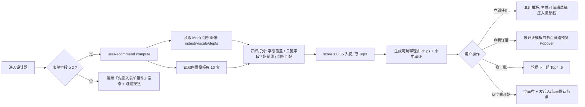

# 审批流前端设计文档（仿钉钉 · 流程推荐器 + 流程设计器）

> 版本：v1.0 ｜ 状态：设计稿（待评审） ｜ 面向：`frontend/` 模块
> 技术基线：Vue 3.5.43 + TypeScript 5.9.3 + Vite 8.3.0 + Element Plus 2.14.6 + Pinia 4.0.3 + VueUse 15.0.0
> **范围声明：本文档为「纯前端」设计，全部数据来自本地 Mock（`src/views/approval/mock/`），不新增任何后端接口、不改动现有 OCR 业务代码。**

---

## 1. 目标与范围

### 1.1 产品目标

在 PaddleOCR-web 前端中新增一个**审批流配置中心**，视觉与交互对齐钉钉审批后台的「表单 + 流程设计器」，核心卖点是：

1. **懂你所想**：进入设计器先看到「流程推荐器」，基于表单字段自动推荐 3 套可直接使用的流程模板（可解释、一键套用），而不是从空白画布开始。
2. **所见即所得**：三栏式画布设计器（左侧节点/推荐 → 中间流程图 → 右侧属性面板），拖拽/点击加号即可编排流程。
3. **零后端可用**：流程定义、组织架构、模板库全部本地 Mock + `localStorage` 持久化，可独立演示与验收。

### 1.2 一期范围（In Scope）

| 模块 | 内容 |
|------|------|
| 流程列表页 | 列表、启用/停用、**复制流程**、删除、进入设计器 |
| 流程推荐器 | 场景画像输入 → 规则打分 → Top3 模板卡片 + 命中理由 → 一键套用/换一批 |
| 流程画布 | 节点拖拽、加号添加、分支/条件、缩放平移、撤销重做、自动保存草稿 |
| 属性面板 | 审批人/抄送人/条件/表单权限配置（上下文联动） |
| 校验与发布 | 启用前校验、错误清单定位、只看预览模式、JSON 查看与导入导出 |

### 1.3 二期范围（Out of Scope）

流程运行实例（发起审批、待办流转）、流程版本 diff、服务端持久化、真实组织架构接口、条件表达式高级模式（公式编辑器）。

---

## 2. 信息架构与路由

```ts
// src/router/index.ts 追加（懒加载，遵循现有写法）
{ path: '/approval/flow', name: 'ApprovalFlowList',   component: () => import('@/views/approval/FlowListView.vue') },
{ path: '/approval/flow/design',  name: 'ApprovalFlowDesign',  component: () => import('@/views/approval/FlowDesignerView.vue') },
{ path: '/approval/flow/preview/:id', name: 'ApprovalFlowPreview', component: () => import('@/views/approval/FlowPreviewView.vue'), props: true }
```

设计态与预览态**共用同一套画布组件**，通过 `readonly` prop 切换（预览隐藏加号、禁用拖拽、不显示推荐侧栏）。

---

## 3. 目录结构

```
src/
├── types/
│   └── flow.ts                      # 流程/节点/条件/组织 类型定义（单一真源）
├── views/approval/
│   ├── FlowListView.vue             # 列表页
│   ├── FlowDesignerView.vue         # 设计器页面（三栏编排）
│   ├── FlowPreviewView.vue          # 只读预览页
│   └── mock/
│       ├── flowTemplates.ts         # 内置模板库（10 套）
│       ├── orgUsers.ts              # 部门/成员/角色 Mock
│       └── formFields.ts            # 表单字段池 Mock
├── components/approval/             # 纯 UI，不直接调 store
│   ├── FlowToolbar.vue              # 顶部工具栏
│   ├── FlowRecommendPanel.vue       # 推荐器面板（侧栏第一 Tab）
│   ├── FlowTemplateCard.vue         # 推荐卡片（命中环 + 理由 chips）
│   ├── FlowNodePalette.vue          # 侧栏第二 Tab：可拖拽节点源
│   ├── FlowCanvas.vue               # 画布（缩放/平移/SVG 层挂载）
│   ├── FlowEdgeLayer.vue            # 连线层（贝塞尔曲线 + 箭头）
│   ├── FlowNodeCard.vue             # 通用节点卡片
│   ├── FlowBranchNode.vue           # 条件/并行分支容器（N 列）
│   ├── FlowNodeAddButton.vue        # 悬停出现的圆形加号
│   ├── FlowPropertyPanel.vue        # 右侧属性面板（按节点类型路由子组件）
│   ├── FlowApproverConfig.vue       # 审批人配置
│   ├── FlowCcConfig.vue             # 抄送人配置
│   ├── FlowConditionConfig.vue      # 条件分支配置
│   ├── FlowValidateDrawer.vue       # 校验错误清单
│   └── FlowJsonDrawer.vue           # JSON 查看/导入
├── composables/approval/
│   ├── useFlowGraph.ts              # 图结构增删改 + 撤销重做
│   ├── useFlowLayout.ts             # 递归布局计算（纯函数，出坐标）
│   ├── useFlowValidate.ts           # 校验规则集
│   └── useRecommend.ts              # 推荐打分引擎
├── stores/
│   └── flow.ts                      # Pinia setup store
└── utils/
    └── flowSerializer.ts            # 序列化/反序列化/导入导出校验
```

> 依赖方向：`views → composables/stores → types/utils`；`components/` 保持纯 UI（除 `FlowCanvas.vue` 必须的容器尺寸测量外不碰 DOM 逻辑）。

---

## 4. 视觉布局（仿钉钉）

### 4.1 页面骨架

```
┌────────────────────────────────────────────────────────────────────────────────┐
│ ← 返回   报销申请流程 ✎     ● 已保存        [撤销][重做] [预览] [校验并启用] ⋯  │ 56px 顶栏
├───────────────┬──────────────────────────────────────────┬─────────────────────┤
│  推荐  节点   │                                          │  审批人              │
│ ┌───────────┐ │              ╔══════════════╗             │  ─────────────────  │
│ │🏆 98%     │ │              ║  发起人 张三  ║             │  审批人来源 [主管▾] │
│ │费用报销   │ │              ╚══════╤═══════╝             │  多级主管 [2 级  ▾] │
│ │命中 4/5   │ │                     │                     │  审批方式 ○依次     │
│ │#含金额字段│ │              ╔══════╕═══════╗             │          ○会签      │
│ │#多级审批  │ │              ║ 审批人 直属主管║             │          ○或签      │
│ │[立即使用] │ │              ╚══════╤═══════╝             │  为空时  [自动跳过▾]│
│ │[查看,细节▾]│ │                ┌─────┴─────┐              │  ─────────────────  │
│ └───────────┘ │         ╔══════╧══╗ ╔══════╧══╗           │  表单权限 [编辑✎]   │
│ ┌───────────┐ │         ║条件:金额≥1万║ ║其他情况 ║           │                     │
│ │🏆 87%     │ │         ╚══════╤══╝ ╚══════╤══╝           │                     │
│ │通用报销   │ │      ╔══════╧═╗    ╔═════╧═╗              │                     │
│ │[立即使用] │ │      ║总监审批 ║    ║经理审批║              │                     │
│ └───────────┘ │      ╚══════╤═╝    ╚═════╤═╝              │                     │
│               │              └──────┬──────┘              │                     │
│ ── 拖拽源 ──  │              ╔══════╧═══════╗             │                     │
│ 审批人  抄送  │              ║  抄送人 财务   ║             │                     │
│ 条件分支 并行 │              ╚══════╤═══════╝             │                     │
│               │              ╔══════╧═══════╗             │                     │
│               │              ║    结束       ║   [50%▾][适应]│                   │
├───────────────┴──────────────────────────────────────────┴─────────────────────┤
  240px                        自适应 flex:1                        320px
```

### 4.2 设计 Token

| 项 | 值 | 说明 |
|---|---|---|
| 主色 / 品牌蓝 | `#1677FF` | 钉钉蓝，用于主按钮、选中态、连线的激活色 |
| 主色 hover / active | `#4096FF` / `#0958D9` | 按钮态 |
| 成功绿 | `#22B35E` | 抄送人节点、启用状态 |
| 警示橙 | `#FF9A2E` | 审批节点、推荐命中理由标签 |
| 危险红 | `#F5483B` | 校验失败节点描边、删除操作 |
| 分支紫 | `#7C6BFF` | 条件分支/并行分支节点 |
| 中性文字 | `#171A1D` / `#5A6470` / `#8A94A6` | 一级/二级/三级文字 |
| 分割线与边框 | `#E4E6EB` / `#F2F3F5` | 卡片描边 / 画布底色网格 |
| 画布底色 | `#F7F8FA` + 网格点 `#E4E6EB`（`radial-gradient` 16px 点阵） | |
| 圆角 | 卡片 8px / 按钮 6px / Tag 4px | |
| 阴影 | `0 2px 8px rgba(23,26,29,.08)` | 卡片常规 |
| 阴影（浮起） | `0 6px 20px rgba(23,26,29,.14)` | 拖拽中、Popover |
| 节点尺寸 | 240×72 / 分支列宽 240 / 纵向间距 32 / 分支横向间距 48 | 1:1 缩放基准 |
| 字号 | 标题 14/500，正文 13/400，辅助 12/400 | |
| 动效时长 | 120ms 进入，180ms 离开（`cubic-bezier(.34,.69,.1,1)`） | |
| z-index | 画布 1 / 连线 2 / 加号 5 / Popover 1000 / Drawer 2000 | |

### 4.3 节点视觉规范

| 节点类型 | 左侧色条 | 图标 | 卡片内容 |
|---|---|---|---|
| `start` 发起人 | `#1677FF` | `User` | 标题「发起人」+ 副标题「谁可以发起：全体员工」（130px 后省略） |
| `approval` 审批人 | `#FF9A2E` | `Stamp` | 标题「审批人」+ 头像组（`el-avatar` 30px，最多 3 个，`+N` 折叠）+ 审批方式角标（依次/会签/或签） |
| `cc` 抄送人 | `#22B35E` | `Message` | 标题「抄送人」+ 头像组 |
| `condition` 条件分支 | `#7C6BFF` | `Share` | 标题「条件分支」+ 分支数 Badge |
| `parallel` 并行分支 | `#7C6BFF` | `Operation` | 标题「并行分支」+ 分支数 Badge |
| `end` 结束 | `#8A94A6` | `CircleCheck` | 标题「结束」 |

选中态：`border-color: #1677FF` + `box-shadow: 0 0 0 3px rgba(22,119,255,.12)`；错误态：`border-color: #F5483B` + 右上角 `WarningFilled` 红标。

---

## 5. 数据模型（`src/types/flow.ts`）

```ts
/** 节点类型 */
export type FlowNodeType = 'start' | 'approval' | 'cc' | 'condition' | 'parallel' | 'end'

/** 审批人来源 */
export type ApproverSource =
  | 'assignUser'      // 指定成员
  | 'assignRole'      // 指定角色
  | 'deptLeader'      // 部门主管（可多级）
  | 'initiator_self'  // 发起人自己
  | 'initiator_pick'  // 发起人自选
  | 'formUser'        // 表单内成员字段

/** 多人审批方式 */
export type ApproveMode = 'sequential' | 'jointly' | 'anyone'  // 依次 / 会签 / 或签

/** 审批人为空时的兜底策略 */
export type EmptyStrategy = 'skip' | 'transferAdmin' | 'initiatorPick'

/** 表单字段可见性 */
export type FieldPerm = 'edit' | 'read' | 'hidden'

export interface OrgUser {
  id: string
  name: string
  avatar: string        // Mock：本地色块首字母或 @element-plus/icons 兜底
  deptId: string
  title: string         // 职位
}

export interface FlowFormField {
  key: string           // 如 amount / days / type
  label: string
  dataType: 'number' | 'string' | 'date' | 'enum' | 'dept' | 'user'
  unit?: string         // 元 / 天
  enumOptions?: Array<{ value: string; label: string }>
}

/** 条件：单条规则 */
export interface FlowConditionRule {
  id: string
  fieldKey: string
  operator: 'gt' | 'gte' | 'lt' | 'lte' | 'eq' | 'ne' | 'in' | 'between'
  value: string | number | string[]
  // 多规则连接
  join: 'and' | 'or'
}

/** 分支列（条件分支的一个分支 / 并行分支的一条线） */
export interface FlowBranch {
  id: string
  name: string
  isDefault: boolean        // 条件分支的「其他情况」，全图每分支组唯一
  conditions: FlowConditionRule[]
  children: FlowNode[]      // 该列后续的节点链
}

export interface FlowNode {
  id: string
  type: FlowNodeType
  name: string
  // approval
  approver?: {
    source: ApproverSource
    userIds: string[]
    roleIds: string[]
    leaderLevel: number      // 多级主管层级，1..5
    mode: ApproveMode
    emptyStrategy: EmptyStrategy
  }
  // cc
  ccUserIds?: string[]
  ccAllowAdd?: boolean       // 允许发起人添加抄送人
  // condition / parallel
  branches?: FlowBranch[]
  // 表单权限
  fieldPerms?: Record<string, FieldPerm>
  // 备注说明
  remark?: string
}

/** 整张流程图（序列化单元，也是导出 JSON 的根对象） */
export interface FlowGraph {
  id: string
  name: string
  icon: string
  groupId: string
  version: number            // 乐观锁占位，纯前端自增
  formFields: FlowFormField[]
  start: FlowNode            // type === 'start'，children 通过 next 串联
  remark: string
  enabled: boolean
  updateTime: number         // 毫秒时间戳
}

/** 布局产物：由 useFlowLayout 计算，不入库 */
export interface LaidOutNode {
  node: FlowNode
  x: number
  y: number
  w: number
  h: number
  parentBranchId?: string
}

export interface FlowEdge {
  id: string
  from: string
  to: string          // 节点 id 或 分支容器 id
  kind: 'normal' | 'branch-head' | 'branch-tail'
  active: boolean     // 预览态高亮/校验定位
}
```

> 红线遵循：ID 一律 `string`；时间一律 `number`（毫秒）；禁用 `any`；所有 `interface` 单一真源，禁止在组件里重复声明同构类型。

---

## 6. 流程推荐器设计（核心亮点）

### 6.1 交互流程



### 6.2 打分算法（`useRecommend.ts`）

```ts
interface RecommendInput {
  formFields: FlowFormField[]
  profile: { industry: string; staffScale: 'small' | 'medium' | 'large'; hasMultiDept: boolean }
}

interface RecommendResult {
  templateId: string
  score: number                 // 0..1，保留 2 位
  matched: MatchedReason[]      // 可解释命中项
  missed: string[]              // 缺失项（用于「还需补充」提示）
}

const WEIGHT = {
  fieldCoverage: 0.45,          // 表单字段与模板所需字段的覆盖率
  keyFieldHit: 0.30,            // 模板「关键字段」是否命中（如报销必含 amount）
  sceneKeyword: 0.15,           // 表单名/字段名的场景词命中（报销、请假、用章…）
  orgMatch: 0.10                // 员工规模/多部门 与模板复杂度匹配
} as const
```

| 维度 | 计算方式 | 示例 |
|---|---|---|
| `fieldCoverage` | `|intersect(template.fields, form.fields)| / template.fields.length` | 模板需 5 字段，命中 4 → `0.80` |
| `keyFieldHit` | 模板 `keyFields` 全命中 = 1；缺 1 个 = 0.5；缺 ≥2 = 0 | 报销缺 `amount` → 0 |
| `sceneKeyword` | 表单名/字段 label 的分词与模板 `keywords` 交集占比 | 「差旅费/金额/天数」→ 出差模板命中 |
| `orgMatch` | 员工规模与模板审批层数差 ≤1 → 1；差 2 → 0.6；否则 0.2 | 大企业 + 3 层审批 = 1 |

- 排序：`score` 降序，同分按模板 `heat`（内置热度）降序。
- 阈值：`score >= 0.35` 进榜，否则不推荐；推荐数为 0 时展示「未找到匹配模板，从空白开始」。
- **可解释性**：每个模板必须产出 ≥1 条 `matched`，以 `#灰底 chip` 呈现（如 `#含金额字段`、`#匹配三级审批`、`#多部门场景`）；`missed` 以「建议补充：费用明细」提示。
- 推荐结果**只生成草稿**，`localStorage` 另存 `flow:draft:{id}`，不直接覆盖已保存流程，避免误伤。

### 6.3 推荐卡片视觉

```
┌────────────────────────────────┐
│  ⭕ 98%        费用报销审批  ★4.8 │   ← 命中率 SVG 环（36px，色 #1677FF）+ 标题 + 内置热度
│  财务部 · 3 级审批 · 约 1.2 万人使用│   ← 副标题
│  #含金额字段  #多级审批  #需财务复核 │   ← el-tag size small 圆角 chips
│  ⚠ 建议补充：费用明细表            │   ← 缺失提示（有则显示）
│  ─────────────────────────────  │
│  [查看细节 ▾]        [立即使用]   │   ← 次按钮 + 主按钮
└────────────────────────────────┘
```

- 「立即使用」：`ElMessageBox.confirm('将覆盖当前画布草稿，是否继续？')` → 套用（空画布时不提示）。
- 「查看细节」：`el-popover` 展示该模板的纵向节点链路缩略图（`FlowPreviewGraph` 只读小图 240px）。
- 「换一批」：面板底部文字按钮，取第 4~6 名，禁用条件 = 总榜不足 6 个。

---

## 7. 画布与节点交互

### 7.1 节点链式结构

采用「**直线链表 + 分支容器**」模型（与钉钉一致）：

```
start → nextId → approval1 → nextId → condition(branches[2]) → nextId(汇聚) → cc → end
                                        ├─ branch A: [ approval2 ]
                                        └─ branch B(default): [ approval3 ]
```

- 非分支节点：`nextId` 指向后继节点（可能为 null，表示未连接到结束）。
- 分支节点：`branches[]` 每列是一个节点链数组，列尾自动汇聚到分支节点的 `nextId`。
- 拖拽/增删统一走 `useFlowGraph.ts` 的受控 API，组件只发意图。

### 7.2 交互清单

| 交互 | 行为 | 反馈 |
|---|---|---|
| 悬停节点 | 下方 16px 处浮出 ⊕ 圆形按钮（`#1677FF` 24px）；此后移 300ms 消失 | 出现动画 scale(.6→1) 120ms |
| 点击 ⊕ | 弹出圆形/列表菜单：审批人 / 抄送人 / 条件分支 / 并行分支 | ElPopover |
| 从左侧拖入画布 | 拖拽源半透明浮起；画布高亮最近可插入锚点（虚线占位卡）；松手插入 | 插入后选中并滚动入视野 |
| 点击节点 | 右侧面板切换；左侧 | `activeNodeId` 变化，deep watch 触发脏标记 |
| 双击节点标题 | 行内编辑（`el-input` 失焦/回车提交，Esc 取消） | 最长 30 字，超长 ElMessage 提示 |
| 悬停分支头 | 分支头右侧出现「+ 添加条件」；分支列头出现更多菜单（复制/删除/设为默认） | 至少保留 2 列才能删除 |
| 拖拽画布 | 空白处按下拖动平移（VueUse `useDragInWindow` 思路，自实现 pointer 事件） | `cursor: grab/grabbing` |
| 滚轮 | Ctrl/⌘ + 滚轮缩放（50%~150%，步进 5%），普通滚轮纵向平移 | 右下角显示比例 |
| Ctrl+Z / Ctrl+Shift+Z | 撤销 / 重做（栈深 50，超了丢最早） | 按钮 disabled 联动 |
| Delete / Backspace | 删除选中节点（起点/终点不可删），二次确认仅对分支生效 | ElMessage 可撤销提示（5s 内「撤销」） |
| 自动保存 | 图变更 `watchDebounced` 1.5s → 写 `localStorage['flow:draft:{id}']` | 顶栏状态「保存中… / 已保存 HH:mm:ss」 |
| 离开页面 | `onBeforeRouteLeave` + `useEventListener('beforeunload')`，脏数据二次确认 | |

### 7.3 布局算法（`useFlowLayout.ts`，纯函数）

1. 深度优先后序遍历，先算每个节点的**子树总高** `subHeight`；
2. 同层节点 y = 上一个节点 y + 高度 + 32；
3. 分支：列宽 240 + 间距 48，`branchX(i) = containerX + i*(240+48)`，整组宽度 `n*240 + (n-1)*48`；
4. 分支列的子链垂直堆叠，列高取 `max(列内链高, 72)`；
5. 汇聚点 y = `max(各列底部 y) + 32`；
6. 返回扁平化的 `{ nodes: LaidOutNode[], edges: FlowEdge[], width, height }`，供 `FlowCanvas` 绝对定位 + SVG 连线。

连线：`cubic-bezier` 三次贝塞尔，`M x1 y1 C x1 y1+24, x2 y2-24, x2 y2`；`marker-end` 箭头 `#C0C4CC`，激活/路径高亮时 `#1677FF` + 2px；分支汇聚线与分叉线共用同一套 `kind` 区分渲染样式（汇聚线额外画水平归集横线）。

### 7.4 预览态运行时高亮（增强项）

`FlowPreviewView` 支持输入一组 Mock 表单值 → 前端本地跑一遍路由判定（顺序 traversing + 条件求值）→ **绿色流光动画**沿路径依次点亮（`stroke-dasharray` + `animation`），直观展示「这条数据会走到谁那里」，非常适合演示。条件求值放 `utils/flowSerializer.ts` 同目录的 `flowRunner.ts`。

---

## 8. 属性面板配置

### 8.1 审批人（`FlowApproverConfig.vue`）

| 配置项 | 控件 | 说明 |
|---|---|---|
| 审批人来源 | `el-select`（分段按钮样式） | 指定成员 / 角色 / 部门主管 / 发起人自己 / 发起人自选 / 表单内成员字段 |
| 具体对象 | `el-select` multiple + filterable（`orgUsers` Mock） | 来源为 member/role 时出现；最多 20 个 |
| 主管层级 | `el-select` 1~5 级 | 仅「部门主管」出现；副标题显示「找不到时自动向上 / 到顶为止」 |
| 多人审批方式 | `el-radio-group` | 依次审批 / 会签（需全通过）/ 或签（一人通过即可） |
| 审批人为空时 | `el-select` | 自动跳过 / 转交给流程管理员 / 发起人自选，默认「自动跳过」 |
| 表单权限 | `el-collapse` + 每行 `el-radio` 编辑/只读/隐藏 | 默认全部「编辑」，隐藏字段数 > 0 时节点卡显示「N 个字段隐藏」角标 |
| 节点说明 | `el-input` textarea，200 字 | 展示在节点卡右上角 `InfoFilled` 的 tooltip |

### 8.2 条件分支（`FlowConditionConfig.vue`）

- 面板中部为**条件列表**：每行 `[字段 ▾] [运算符 ▾] [值输入框/下拉]`，行间 `AND/OR` 切换器（钉钉为 OR/AND 顶部切换 + 组内统一）。
- 数据类型联动运算符：`number` → gt/gte/lt/lte/eq/ne/between；`enum` → eq/ne/in；`date` → before/after/between。联动用 `computed` 返回可选算子表，**禁止**手写多份分支逻辑。
- 值控件随 `dataType` 动态：`number` → `el-input-number`（带单位后缀）；`enum` → `el-select` multiple；`date` → `el-date-picker`；`dept/user` → 选择器（Mock）。
- 「其他情况」列：`isDefault: true`，不可配条件、永远是最后一列、不可删除，卡片显示灰色「其他情况」。
- 拖拽排序：条件列支持横向拖拽换位（`vuedraggable` **不引入**，用手写 pointer + `:key="branch.id"` 保证不复用错乱）。

### 8.3 抄送人（`FlowCcConfig.vue`）

成员多选 + 「允许发起人添加抄送人」开关 + 「抄送时机」单选（审批通过后 / 发起后立即），默认审批通过后。

---

## 9. 状态管理（`stores/flow.ts`，setup store）

```ts
export const useFlowStore = defineStore('flow', () => {
  const graph = ref<FlowGraph | null>(null)
  const activeNodeId = ref<string>('')
  const dirty = ref(false)
  const saveState = ref<'idle' | 'saving' | 'saved'>('idle')
  const errors = ref<FlowValidateError[]>([])
  const past = ref<FlowGraph[]>([])      // 撤销栈，深拷贝快照，上限 50
  const future = ref<FlowGraph[]>([])    // 重做栈

  const nodeMap = computed(() => buildNodeMap(graph.value))        // id -> FlowNode
  const layout = computed(() => calcLayout(graph.value!))           // useFlowLayout 纯函数
  const activeNode = computed(() => nodeMap.value.get(activeNodeId.value) ?? null)
  const canUndo = computed(() => past.value.length > 0)
  const canRedo = computed(() => future.value.length > 0)

  // 受控写操作统一入口：写前 pushHistory 快照
  function commit(mutator: (draft: FlowGraph) => void): void { /* ... */ }
  function undo(): void
  function redo(): void
  function addNode(parentId: string, type: FlowNodeType): void
  function removeNode(id: string): void
  function updateNode(id: string, patch: Partial<FlowNode>): void
  function addBranch(groupId: string): void
  function removeBranch(groupId: string, branchId: string): void
  function applyTemplate(templateId: string): void   // 推荐器套用 -> commit
  function validate(): FlowValidateError[]
  function saveDraft(): void                          // localStorage
  function reset(): void

  return { graph, activeNodeId, dirty, saveState, errors, layout, nodeMap, activeNode,
           canUndo, canRedo, commit, undo, redo, addNode, removeNode, updateNode,
           addBranch, removeBranch, applyTemplate, validate, saveDraft, reset }
})
```

- store 内**不调用** `ElMessage`（UI 反馈交给调用方组件），遵循现有规范。
- 快照方式：一次性 `JSON.parse(JSON.stringify(graph))`（Mock 数据量小，可控），避免响应式代理污染历史。
- 自动保存：`watchDebounced(graph, saveDraft, { debounce: 1500 })`（VueUse）。

---

## 10. Mock 数据清单

| 文件 | 内容 | 规模 |
|---|---|---|
| `mock/orgUsers.ts` | 6 个部门（总经办/财务/人事/技术/市场/行政）× 8~12 人；角色：管理员、财务主管、部门主管、法务 | ≈ 60 人 |
| `mock/formFields.ts` | 字段池：`amount`、`costType`、`days`、`applyReason`、`startDate`、`attachment`、`dept`、`expenseDetail`、`leaveType`、`useType` 等 | ≈ 24 个 |
| `mock/flowTemplates.ts` | 10 套模板：请假、加班、**费用报销**、出差、采购申请、付款申请、合同审批、用章申请、招聘需求、转正申请 | 每套 3~7 节点 |
| 列表页 Mock | `FlowListView` 初始 6 条流程记录（含启用/停用、更新时间、使用次数） | 6 条 |

模板结构示例：

```ts
// src/views/approval/mock/flowTemplates.ts
export interface FlowTemplate {
  id: string
  name: string
  icon: string
  heat: number                 // 内置热度
  keywords: string[]           // 场景关键词
  requiredFields: string[]     // 覆盖率分母
  keyFields: string[]          // 关键字段（命中则 +keyFieldHit）
  suitScale: Array<'small' | 'medium' | 'large'>
  graph: Omit<FlowGraph, 'id' | 'updateTime'>   // 可直接实例化的图
}

export const FLOW_TEMPLATES: FlowTemplate[] = [ /* ... */ ]
```

---

## 11. 校验规则（`useFlowValidate.ts`）

点击「校验并启用」时全量校验，返回 `FlowValidateError[]`（`nodeId` + `message` + `level`），画布上错误节点红框，右侧抽屉列出清单，点击条目 `scrollIntoView` 定位并选中。

| 规则 ID | 级别 | 描述 |
|---|---|---|
| `R01` | error | 存在未配置审批人的审批节点 |
| `R02` | error | 条件分支存在未配置条件的非默认列 |
| `R03` | error | 条件分支无「其他情况」默认列 |
| `R04` | error | 流程无有效审批节点（仅发起人 + 结束） |
| `R05` | error | 分支内链路为空（只有空列无节点） |
| `R06` | error | 存在悬空节点（不可从发起人到达） |
| `W01` | warning | 存在前后连续的重复审批人 |
| `W02` | warning | 抄送人未配置成员 |
| `W03` | warning | 存在审批节点，但所有人字段权限均为「隐藏」 |

规则表用 `Array<{ id, level, test(g: FlowGraph): FlowValidateError[] }>` 声明式组织，禁止散落 if。

---

## 12. 快捷键

| 快捷键 | 功能 |
|---|---|
| `Ctrl/⌘ + Z` | 撤销 |
| `Ctrl/⌘ + Shift + Z` | 重做 |
| `Ctrl/⌘ + S` | 立即保存草稿（阻止默认行为） |
| `Delete / Backspace` | 删除选中节点 |
| `Ctrl/⌘ + D` | 复制选中节点到其后 |
| `Ctrl/⌘ + 0` | 缩放重置 100% |
| `Ctrl/⌘ + +/-` | 放大 / 缩小 |
| `Esc` | 取消选中 / 关闭 Popover |

统一注册在 `FlowDesignerView.vue` 的 `useEventListener('keydown')`，输入框聚焦时跳过（`event.target` 为 input/textarea 时 return）。

---

## 13. 空态、异常态与兜底

| 场景 | 展示 |
|---|---|
| 推荐器无匹配模板 | 「暂无匹配模板」插画 + 灰字「试试从空白创建」+ 主按钮「从空白开始」 |
| 首次进入空画布 | 画布中央虚线卡片：「从左侧拖入节点开始，或点击 ⭐ 推荐一套流程」 |
| 草稿加载失败 / JSON 非法 | `ElMessage.error('草稿已损坏，已重置为空白流程')` + 本地备份到 `flow:draft-broken:{id}` |
| 导入 JSON 结构不符 | `FlowJsonDrawer` 内红字列出缺失字段，导入按钮 disabled |
| 节点数 > 200 | 顶部黄条提示「节点过多可能影响性能，建议拆分子流程」，画布仍可用 |
| 窄屏（< 1280px） | 左右侧栏自动折叠为图标条 + `el-drawer` 弹出，画布保持可用 |

---

## 14. 性能与可访问性

- 连线层为**单个 `<svg>`** 内批量 `path`，不要每节点一个 svg；节点层用绝对定位 + `transform`，避免频繁 reflow。
- 布局计算放 `computed`，仅当图结构变化重算；缩放平移用 CSS `transform: scale() translate()`，不触发重排。
- `v-for` 一律 `:key="node.id"`（禁止 index）；头像组超过 3 个的折叠用 `slice`，不渲染多余 DOM。
- 节点标题等文本全部 `{{ }}` 插值，**禁止 `v-html`**（Mock 文案亦如此，保持一致性）。
- 画布节点的「打开配置」等能力必须同时支持键盘：`tabindex="0"` + Enter/Space 触发选中，方向键在同层节点间移动焦点。

---

## 15. 验收清单

- [ ] 流程列表：复制、删除、启用/停用生效，刷新后（localStorage）状态保持
- [ ] 推荐器：≥3 个场景（报销/请假/出差）能稳定推荐出对应 Top1 模板，理由 chips ≥1 条
- [ ] 「立即使用」后画布出现完整节点链路且可继续编辑；析构—重做可回到套用前
- [ ] 拖拽新增审批人/抄送人/条件分支，连线自动重排无重叠
- [ ] 分支增删 column 后布局自动居中，汇聚线正确
- [ ] 条件配置随 `dataType` 动态切换运算符与值控件
- [ ] 「校验并启用」触发 R01~R06，错误定位可点，修正后错误消失、可启用
- [ ] 撤销/重做 50 步栈正常；自动保存 1.5s 后状态变「已保存」
- [ ] 缩放 50%~150%、拖拽平移、适应画布均正常，`Ctrl+0` 复位
- [ ] 预览态隐藏加号与拖拽；运行时高亮路径与实际条件判定一致
- [ ] 导出 JSON 可被再次导入并还原相同图结构
- [ ] 全程无 `console.log`，`vue-tsc -b` 类型检查通过

---

## 16. 里程碑建议

| 阶段 | 内容 | 产出 |
|---|---|---|
| M1 | 类型模型 + Mock 库 + 布局算法 + 静态画布只读渲染（模板图） | 可预览 10 套模板的流程图 |
| M2 | 推荐引擎 + 推荐面板 + 拖拽/加号增删 + 撤销重做 | 可交互设计器主体 |
| M3 | 属性面板全量配置 + 校验 + 列表页 + 预览高亮 + 导入导出 | 闭环可用 |

---

## 17. 后端接入预留（一期不实现）

后续若接入后端，`useFlowGraph` 的持久化层替换为 `src/api/flow.ts`（`fetchTemplates()` / `fetchFlow(id)` / `submitFlow(graph)` / `enableFlow(id)`）， graph 的 JSON 结构与本文档第 5 节保持一致即可；REST 风格为 `POST /api/approval/flow` 提交、`PUT /api/approval/flow/{id}/enable` 启用，分页沿用 `pageNum/pageSize`，响应对齐 `ApiResponse<T>`（`code === 0` 为成功）。届时推荐引擎如需服务端统一模型，只需替换 `useRecommend.ts` 的取数来源，UI 不变。
